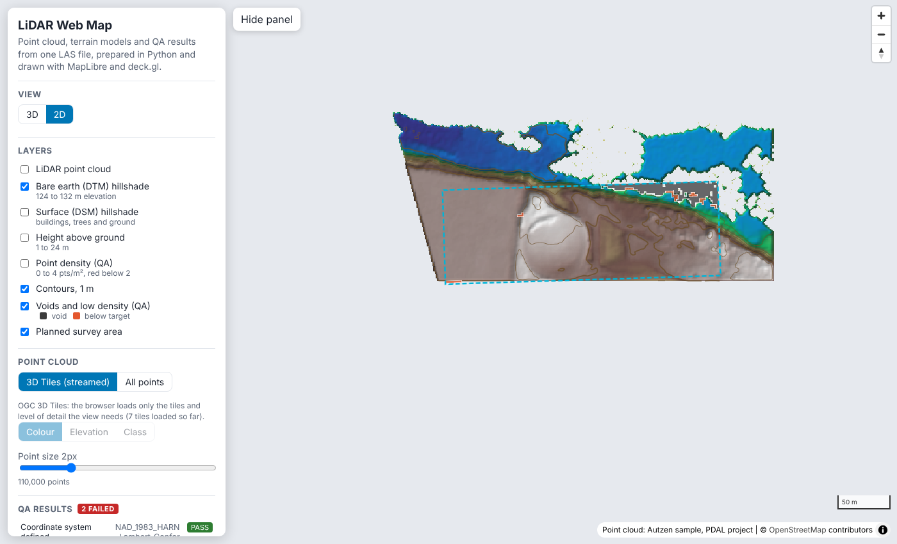

# LiDAR Web Map

**Live demo: https://jjmmcckk.github.io/lidar-web-map/**

One LiDAR file turned into decision ready web layers: the point cloud as streamed 3D Tiles,
bare earth and surface models as Cloud Optimized GeoTIFFs, and contours and QA results as
vector tiles. Everything is static files on GitHub Pages, with no tile server or database.


## Process

1. **Choose and credit the data.** An openly licensed LiDAR sample (Autzen, from the PDAL
   project's test data), chosen because it has the problems real deliveries have: coordinates
   in feet, a mix of classified and unclassified points, and gaps against a planned survey area.
2. **Fix the coordinates first.** Reproject from Oregon Lambert (feet) to UTM zone 10N
   (metres) and convert heights to metres, so every later measurement is in real units.
3. **Build the surfaces.** Grid the highest point per 1 m cell for the surface model (DSM) and
   the mean of ground points for the bare earth model (DTM), fill small gaps by interpolation,
   then derive hillshades, height above ground and 1 m contours.
4. **Check quality before publishing.** Run
   [lidar-qa-toolkit](https://github.com/jjmmcckk/lidar-qa-toolkit) for point density, voids and
   coverage of the planned area, and show the results on the map instead of hiding them.
5. **Package each layer in the format built to stream it:**

   | Layer | Format | How the browser gets it |
   |---|---|---|
   | Point cloud | OGC 3D Tiles (py3dtiles) | Only the tiles and level of detail the view needs |
   | DTM, DSM, height above ground, density | Cloud Optimized GeoTIFF on the Web Mercator tile grid, 256 px blocks with overviews | HTTP range requests for the tiles in view |
   | Contours, voids, planned survey area | Vector tiles in one PMTiles archive (tippecanoe) | HTTP range requests for the tiles in view |
   | Full point cloud (optional) | Float32 metre offsets from a local origin | One download, recoloured on the GPU |

6. **Deliver analysis grade files too.** The DTM and DSM are also published as float32 COGs in
   UTM for GIS use, and the voids as GeoJSON.



## Why these formats

- **3D Tiles** keep a large point cloud usable in a browser: a coarse preview loads first,
  then detail fills in only where the viewer zooms.
- **COGs** let one file serve as both the download and the map layer; the browser reads just
  the bytes for the tiles on screen.
- **PMTiles** packs every zoom level of the vector layers into one file that any static host
  can serve.
- **Metre offsets** for the full cloud keep centimetre precision; plain longitude and latitude
  stored as float32 would lose about half a metre.

## Web app

React and TypeScript, built with Vite into [docs/](docs/) for GitHub Pages:

- MapLibre GL JS for the basemap, the COG rasters (through the
  [MapLibre COG Protocol](https://github.com/geomatico/maplibre-cog-protocol)) and the PMTiles
  vector layers.
- deck.gl's Tile3DLayer for the 3D Tiles point cloud, and PointCloudLayer for the full cloud
  coloured by RGB, elevation or ASPRS class.
- A side panel with layer controls, QA results and downloads.

## Run it yourself

```bash
# 1. Prepare the data (needs tippecanoe on the PATH, or set TIPPECANOE to its location)
pip install -r prep/requirements.txt
bash prep/get_sample_data.sh
python prep/prepare_data.py data/autzen_trim.las --aoi data/autzen_aoi.geojson

# 2. Build and preview the web app
cd web
npm install
npm run dev        # local preview
npm run build      # writes the site to ../docs
```

To use another survey, point `prepare_data.py` at your LAS/LAZ file and pass a projected
coordinate system in metres with `--utm` (for example `EPSG:2958` for NAD83(CSRS) UTM zone 17N
in southern Ontario).

## Data credits

- **Point cloud:** Autzen sample (`autzen_trim.las`) from the
  [PDAL project's test data](https://github.com/PDAL/PDAL/tree/master/test/data/las).
- **Basemap:** © [OpenStreetMap](https://www.openstreetmap.org/copyright) contributors.

## Author

Jordan McKenzie, Transport Canada Advanced RPAS Pilot and Flight Reviewer, B.Sc. Computer
Science. [LinkedIn](https://www.linkedin.com/in/jordan-mckenzie-gis)

MIT License.
