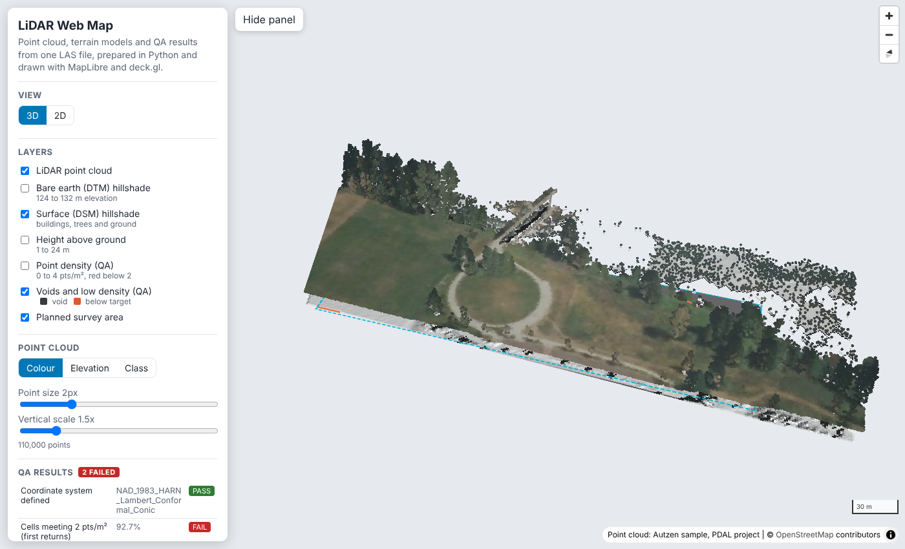

# LiDAR Web Map

**Live demo: https://jjmmcckk.github.io/lidar-web-map/**

An interactive web map built from one LiDAR file: the 3D point cloud, bare earth and surface
models, height above ground, and QA results (point density, voids and low density areas
against a planned survey area), with the rasters available as Cloud Optimized GeoTIFFs.



## What it shows

| Layer | Made from |
|---|---|
| LiDAR point cloud (110,000 points) | Shown in 3D in true colour, by elevation, or by ASPRS class, with adjustable point size and vertical scale |
| Bare earth (DTM) hillshade | Ground points (class 2) gridded at 1 m, gaps interpolated, coloured by elevation |
| Surface (DSM) hillshade | Highest point per 1 m cell: buildings, trees and ground |
| Height above ground | DSM minus DTM, shown from 1 m up |
| Point density, voids and low density | From [lidar-qa-toolkit](https://github.com/jjmmcckk/lidar-qa-toolkit), checked against a 2 pts/m² target |
| Planned survey area | The AOI the QA checks coverage against |

The side panel lists every QA check with pass or fail, and links the DTM and DSM as Cloud
Optimized GeoTIFFs plus the void polygons as GeoJSON.


## How it works

**Data preparation** ([prep/prepare_data.py](prep/prepare_data.py)), in Python with laspy,
pyproj, SciPy and rasterio:

- Reprojects the points from Oregon Lambert (feet) to UTM zone 10N (metres) and converts
  heights from feet to metres.
- Builds the DSM (highest point per cell) and DTM (mean of ground points per cell, gaps
  filled by interpolation and lightly smoothed), then hillshades and height above ground.
- Writes the DTM and DSM as Cloud Optimized GeoTIFFs, and reprojects colour rendered
  versions to Web Mercator PNG overlays with their corner coordinates.
- Packs the points into compact binary files as float32 metre offsets from a local origin,
  which keeps centimetre precision in the browser (plain longitude and latitude in float32
  would lose about half a metre).
- Runs lidar-qa-toolkit for the density grid, void and low density polygons, and checks.

**Web app** ([web/](web/)), in React and TypeScript with MapLibre GL JS and deck.gl:

- deck.gl's PointCloudLayer draws the binary point attributes directly on the GPU, so the
  whole cloud loads without parsing a large JSON file.
- MapLibre draws the raster overlays, GeoJSON QA layers and the OpenStreetMap basemap.
- Vite builds the site into [docs/](docs/), which GitHub Pages serves.

## Run it yourself

```bash
# 1. Prepare the data
pip install -r prep/requirements.txt
bash prep/get_sample_data.sh
python prep/prepare_data.py data/autzen_trim.las --aoi data/autzen_aoi.geojson

# 2. Build and preview the web app
cd web
npm install
npm run dev        # local preview
npm run build      # writes the site to ../docs
```

To use another survey, point `prepare_data.py` at your LAS/LAZ file and pass a projected
coordinate system in metres for the rasters with `--utm` (for example `EPSG:2958` for
NAD83(CSRS) UTM zone 17N in southern Ontario).

## Data credits

- **Point cloud:** Autzen sample (`autzen_trim.las`) from the
  [PDAL project's test data](https://github.com/PDAL/PDAL/tree/master/test/data/las).
- **Basemap:** © [OpenStreetMap](https://www.openstreetmap.org/copyright) contributors.

## Author

Jordan McKenzie, Transport Canada Advanced RPAS Pilot and Flight Reviewer, B.Sc. Computer
Science. [LinkedIn](https://www.linkedin.com/in/jordan-mckenzie-gis)

MIT License.
